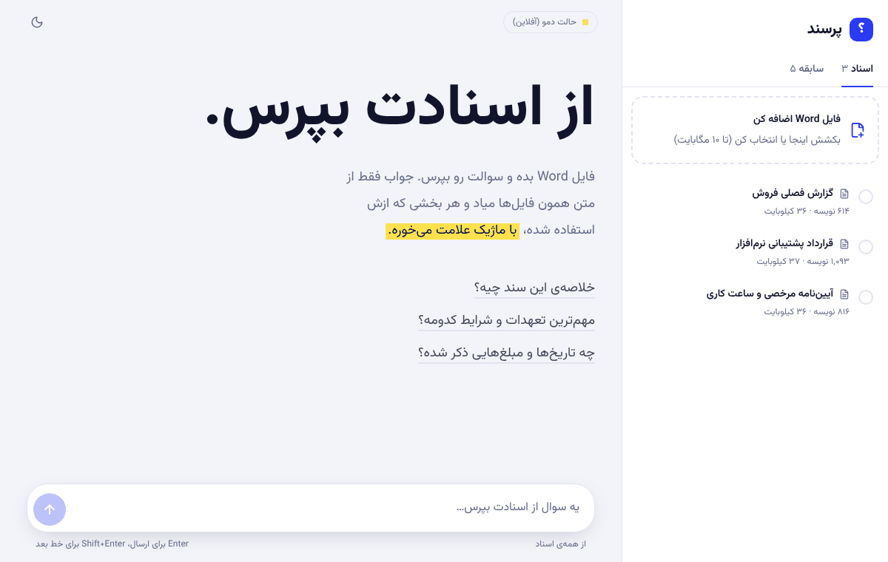
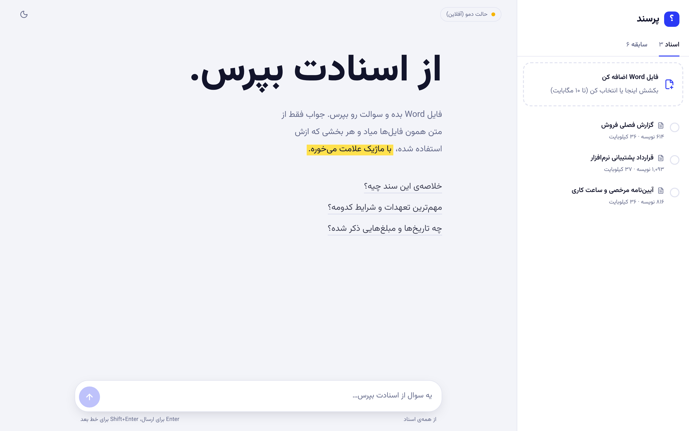
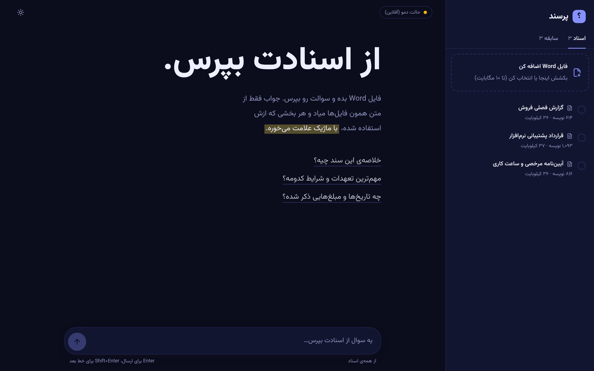
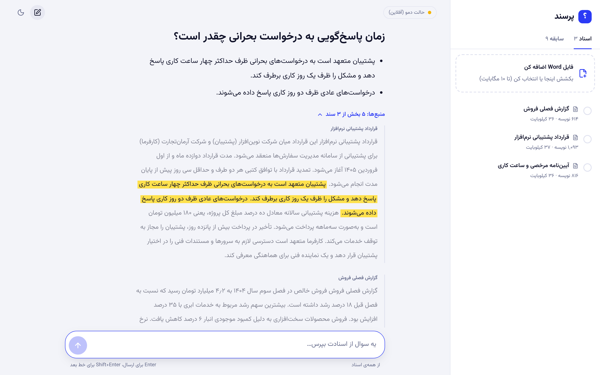
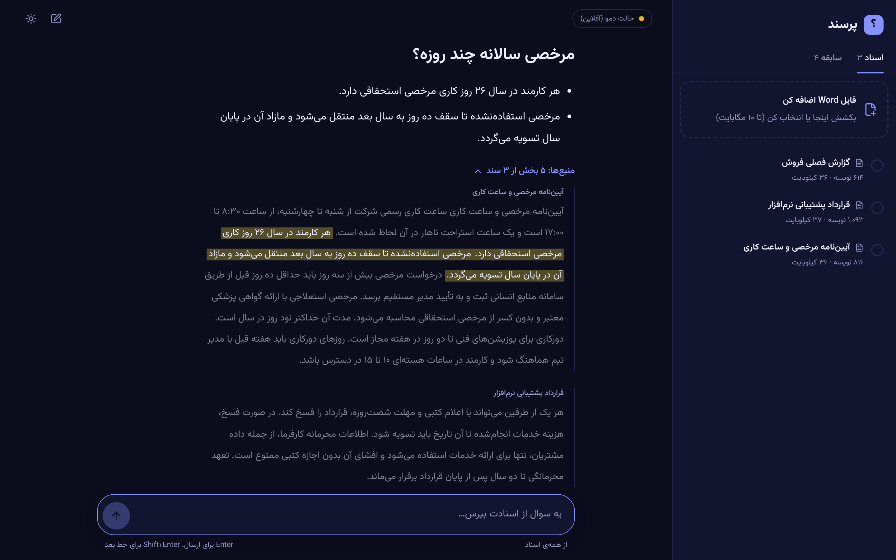
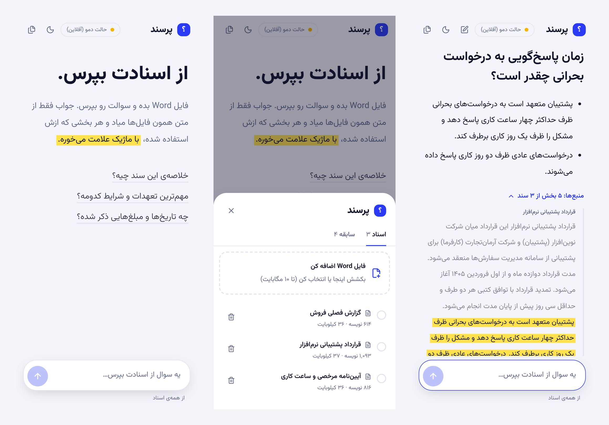
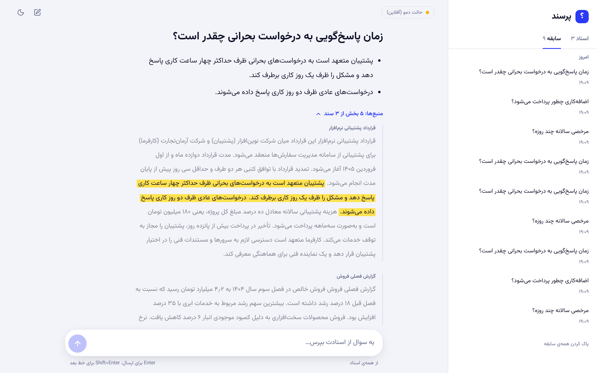
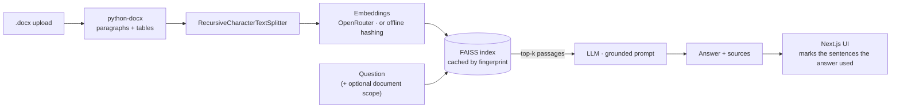

<div align="center">

# پرسند &nbsp;·&nbsp; Porsand

**Ask your Word documents. Get answers with receipts.**

A Persian-first RAG app: upload `.docx` files, ask questions in plain language, and see the exact sentences of your documents that every answer was built from, marked with a highlighter pen.


[](https://github.com/yan-jordan/RAG/actions/workflows/ci.yml)



</div>

> **فارسی:** پرسند یک دستیار پرسش و پاسخ روی فایل‌های Word است. فایل رو بارگذاری می‌کنی، سوال می‌پرسی و جواب فقط از متن همون فایل‌ها میاد؛ جمله‌هایی که پاسخ ازشون ساخته شده با ماژیک زرد علامت می‌خورن. بخش «راه‌اندازی سریع» پایین رو ببین. بدون API key هم با حالت دمو اجرا می‌شه.

---

## What makes it different

Most RAG demos return an answer and a wall of "retrieved context" you have to trust. Porsand shows its evidence:

- **Highlighter-pen evidence.** Retrieved passages are split into sentences and only the ones the answer actually used are marked yellow; the rest of the passage stays muted for context. Works for verbatim and paraphrased answers (`frontend/lib/evidence.ts`).
- **Scope a question to chosen documents.** Tick one or more documents in the side panel and retrieval is restricted to them.
- **A vector index that isn't rebuilt on every question.** The FAISS index is cached in-process, keyed by a fingerprint of the documents and settings, and rebuilt only when something changes (a test pins this behaviour).
- **Failures never poison the corpus.** A corrupt or empty `.docx` is marked `failed` with a readable reason instead of having its error message indexed as if it were document text.
- **Runs without an API key.** `RAG_DEMO_MODE=True` swaps in a local lexical retriever and extractive answers, so anyone can clone and try it.
- **RTL-native UI.** Vazirmatn, Persian digits and dates, light/dark themes, bottom-sheet navigation on phones.

## Screenshots

<table>
  <tr>
    <td width="50%"></td>
    <td width="50%"></td>
  </tr>
  <tr>
    <td width="50%"></td>
    <td width="50%"></td>
  </tr>
</table>

<p align="center"></p>

<p align="center"></p>

> Screenshots were captured in **demo mode** (offline lexical retriever + extractive answers) on the three fictional documents in [`samples/`](samples). With an LLM configured, answers are written by the model; the evidence highlighting works the same way.

## How it works



## Quick start

You need Python 3.10+ and Node 20+.

### 1 · Backend

```bash
python -m venv .venv && source .venv/bin/activate
pip install -r requirements.txt
cp .env.example .env            # then pick one:
                                #   RAG_DEMO_MODE=True            (no key, offline)
                                #   OPENROUTER_API_KEY=sk-or-...  (real embeddings + LLM)
python manage.py migrate
python manage.py seed_demo      # optional: three sample documents + five answered questions
python manage.py runserver      # http://localhost:8000
```

### 2 · Frontend

```bash
cd frontend
cp .env.example .env.local
npm install
npm run dev                     # http://localhost:3000
```

### 3 · Try it

```bash
python scripts/make_samples.py  # (re)writes the three Persian sample .docx files to ./samples
python manage.py seed_demo      # loads them and a few answered questions (--reset starts over)
```

Or drop the files from `samples/` into the app yourself and ask: *«زمان پاسخ‌گویی به درخواست بحرانی چقدر است؟»*

### Docker

```bash
cp .env.example .env            # set OPENROUTER_API_KEY or RAG_DEMO_MODE=True
docker compose up --build       # UI :3000 · API :8000
```

## API

| Method | Path | Notes |
| --- | --- | --- |
| `GET` | `/api/status/` | config + counts; the UI uses it for the status pill |
| `GET` `POST` | `/api/documents/` | `POST` multipart `file` (+ optional `title`); `.docx` only, size-limited |
| `GET` `PATCH` `DELETE` | `/api/documents/{id}/` | `GET` includes `full_text`; `DELETE` also removes the file |
| `POST` | `/api/ask/` | throttled (`ASK_RATE_LIMIT`, default 30/min) |
| `GET` `DELETE` | `/api/history/`, `/api/history/{id}/` | paginated; `DELETE /api/history/clear/` empties it |

```bash
curl -X POST localhost:8000/api/ask/ -H 'Content-Type: application/json' \
  -d '{"question": "مرخصی سالانه چند روزه؟", "document_ids": [1]}'
```

```jsonc
{
  "history_id": 7,
  "question": "مرخصی سالانه چند روزه؟",
  "answer": "هر کارمند در سال ۲۶ روز کاری مرخصی استحقاقی دارد. …",
  "sources": [{ "doc_id": 1, "title": "آیین‌نامه مرخصی و ساعت کاری", "snippet": "…" }],
  "context_retrieved": "…",
  "created_at": "2026-10-26T19:06:11+03:30"
}
```

Errors are explicit: `503 not_configured` (missing key), `502 upstream_error` (provider failed), `400` with field messages.

## Configuration

| Variable | Default | |
| --- | --- | --- |
| `OPENROUTER_API_KEY` | – | required unless demo mode |
| `RAG_DEMO_MODE` | `False` | offline retriever + extractive answers |
| `RAG_CHAT_MODEL` | `openai/gpt-oss-120b:free` | any OpenRouter chat model |
| `RAG_EMBEDDING_MODEL` | `text-embedding-3-large` | |
| `RAG_TOP_K` / `RAG_CHUNK_SIZE` / `RAG_CHUNK_OVERLAP` | `5` / `800` / `120` | |
| `MAX_UPLOAD_MB` | `10` | |
| `ASK_RATE_LIMIT` | `30/min` | |
| `DEBUG`, `SECRET_KEY`, `ALLOWED_HOSTS`, `CORS_ALLOWED_ORIGINS` | see `.env.example` | `SECRET_KEY` is mandatory when `DEBUG=False` |

## Project layout

```
app/                Django app: models, serializers, views, rag_service.py, tests.py
project/            settings (env-driven), urls
frontend/           Next.js + Tailwind UI (see frontend/README.md)
scripts/            make_samples.py
samples/            three fictional Persian .docx files
docs/               screenshots, demo GIF, case study
```

## Tests

```bash
python manage.py test           # 16 tests, no network or API key needed
```

They cover upload validation (type, forged `.docx`, size), table extraction, failed-extraction handling, file cleanup on delete, scoped retrieval, index caching, the LLM path (with a fake chat model), missing-key and history/status endpoints.

## Known limitations

- **No authentication.** Anyone who can reach the API can read and delete documents. Put it behind a reverse proxy or add auth before exposing it.
- **Single-process index cache.** Run one worker (the Docker image does); several workers would each re-embed the corpus.
- **`.docx` only**, SQLite, no streaming responses.
- The real OpenRouter path is covered by tests with fakes, not by live-provider tests.

## Roadmap

PDF support · streaming answers · per-user accounts · hybrid (BM25 + vector) retrieval · persisted vector index.

## License

[MIT](LICENSE)
